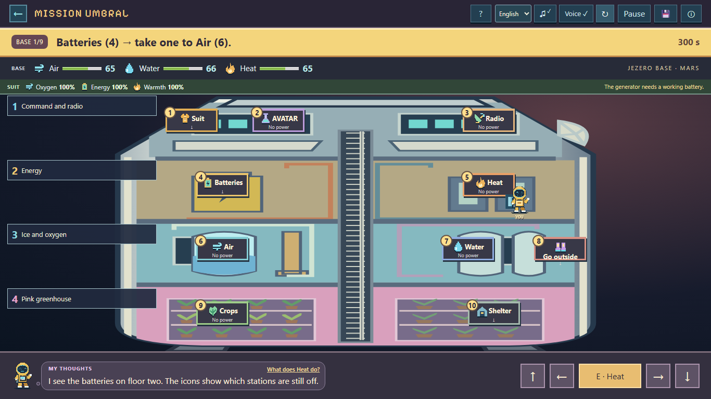

# Mission Umbral · Astronaut Academy

**English** · [Español](README.es.md)

**Small decisions. Great missions.**

An educational web prototype for children ages seven and up. Prepare a suit, organize supplies and help a crew at a simulated Mars base. Every decision combines a benefit with a cost.

**[Play online](https://mision-umbral-academia.jfelipevv-2005.chatgpt.site/juego)** · [Project presentation guide (Spanish)](docs/ENTREGA.md) · [Installation and development (Spanish)](GUIA-DE-INICIO.md)



## The experience

1. **Prepare:** choose three of six upgrades and compare their benefits; select your spacecraft, cargo and shelter protection.
2. **Travel:** follow numbered steps, check controls and conserve water and energy.
3. **Rescue:** explore four floors, distribute four batteries among six stations, repair equipment and grow a harvest.
4. **Investigate and protect:** compare samples in AVATAR, complete the report and overcome a solar alert and an equipment failure.
5. **Reflect:** return with the crew and answer three questions about your decisions.

The game includes keyboard movement and touch controls, explanations for each area, narration and music with separate controls, pause and local saves. Apollo hard mode unlocks after completing Artemis normal mode.

English is the default language. Choose Español in the language selector to switch to Spanish; your choice is saved in the same browser. Narration follows the selected language when a compatible browser voice is available.

## What it teaches

- Resources are limited: all stations cannot operate at once.
- A useful upgrade has costs in mobility, energy or time.
- Preparing a shelter uses capacity that could otherwise carry water.
- Research compares conditions: a flight sample needs an Earth control sample.
- The suit must return to working service points to restore oxygen, energy and warmth.

## Science and representation

The Mars base is a future training concept. Apollo and Orion provide comparative references; those missions did not travel to this base. AVATAR represents research using tissue models, not an implant in the character.

Timings, capacities, mass and consumption are **game rules**, not human safety measurements. Sources and limitations are available in [Science and credits](https://mision-umbral-academia.jfelipevv-2005.chatgpt.site/fuentes) and `data/fuentes.json`. This is an independent project without NASA certification or endorsement.

## Controls

| Action | Control |
|---|---|
| Walk | Left/right arrows or A/D; releasing the key stops movement |
| Change floors | Up/down arrows, using the ladder |
| Approach a station | Click or tap the location |
| Use a nearby location | E or the contextual button |
| Choose upgrades | Drag a card into a slot, or tap the card and slot |
| Save and continue | Save button; continue when returning in the same browser |
| Sound | Separate music and voice controls; repeat narration |
| Language | Select English or Español; the browser remembers your choice |

The browser may require an initial interaction before playing audio. Saves are local: they do not synchronize across devices and may be deleted when browser data is cleared.

## Run and verify

We used Node.js 26 to validate this delivery.

```sh
npm ci
npm run dev
```

Open `http://localhost:4321/juego`.

```sh
npm test
npx tsc --noEmit
npm run build
npm run preview
```

On Windows, use `npm.cmd` and `npx.cmd` if needed.

**Delivery verification:** 140 tests passed; TypeScript checks and the static build passed. Local browser checks cover preparation, recharging, difficulty locking and unlocking, saves, voice and responsive layouts at six sizes. These checks do not replace evaluation with children or guarantee voice availability on every device.

## Organization

- `src/game/`: rules, shared state, saves and progression.
- `src/components/`: scenes, decisions, audio and activities.
- `src/content/`: guidance, explanations and comparisons.
- `src/i18n/`: language selection and English translations.
- `src/styles/`: interface and responsive layouts.
- `public/`: game assets and font licenses.
- `assets/source/`: editable artwork originals.
- `data/`: sources and training data.
- `scripts/`: artwork generation and browser checks.
- `docs/`: project documentation and presentation materials.

Astro + React + TypeScript + CSS, with Vitest for tests. The rules are independent of the browser. Phaser is installed as a project dependency; the current scene uses React and CSS.

## Scope of this delivery

This version is a playable prototype. Extra food and batteries do not yet provide a benefit beyond the required minimum cargo; extra water does change the initial reserve. A historical DONKI event, RTG, delayed radio, dust/mold and crew evacuation have not been integrated. Their development requires further design, balancing and scientific review.

## Team and credits

**Felipe · Jonny Agudelo · Angela Lopez · Samantha Urbano**

Code, text, original illustrations and interface were prepared with AI assistance. Pixelify Sans is distributed under the SIL Open Font License 1.1, included in `public/fonts/`. Visual references guide the composition and do not imply permission to copy brands or logos.
